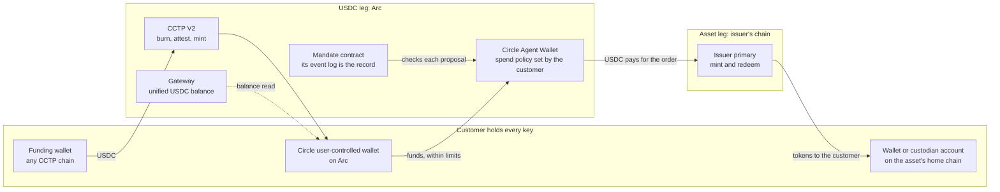

# arc-router

The USDC settlement leg of [Promorphic](https://promorphic.xyz)'s router, on Arc.

## What this is

Promorphic is agentic, cross-chain trading and portfolio management for tokenized assets, for verified investors. Assets stay in the customer's own wallet on their home chain; the stablecoin leg of every subscription, redemption and order settles in USDC; an agent can act inside a human-set mandate (Manual → Copilot → Autopilot). Promorphic never holds or controls a customer asset. In this repository, Arc is where the USDC leg settles and where Dinari dShares trade; USYC is integrated on testnet only.

## Status

Read this first. It is kept current with every push, and nothing below it should contradict it.

- **Live (mainnet):** nothing. No mainnet transaction has been sent from this repository.
- **Testnet, proven with hashes:**
  - A CCTP V2 Fast Transfer moved 5 USDC from Ethereum Sepolia to Arc testnet, from and to a Circle user-controlled wallet, signed with the customer's PIN; 59 seconds from approval to mint.
  - The Mandate contract is deployed on Arc testnet ([`0x2D1CBBEea337a30dF22C0446dB2528B98B543D10`](https://explorer.testnet.arc.io/address/0x2D1CBBEea337a30dF22C0446dB2528B98B543D10)). That Circle wallet set a mandate naming a Circle Agent Wallet, and the Agent Wallet's proposals were executed inside the limits and rejected outside them (over the cap, recipient not allowlisted).
  - A live end-to-end run with test keys also shows over-daily-cap, unapproved (Copilot) and post-revoke proposals being rejected on-chain.
  - Hashes are in [MILESTONES.md](MILESTONES.md); audit record exports are in [`evidence/`](evidence/).
- **Testnet, partly working:** the Gateway unified-balance read works against Circle's testnet API. Nothing has been deposited into Gateway and no Arc-side action has been funded from it.
- **Checked:** every hardcoded chain fact (chain ids, CCTP V2 domains and contracts, Gateway contracts, USYC contracts) against the live testnets by `pnpm verify:chains`, 35 of 35 on 26 Nov 2026.
- **Planned:** milestones M1 to M4 below. Evidence for each (transaction hash, explorer link, date, what it proves) is logged in [MILESTONES.md](MILESTONES.md) as it is produced.

## Architecture: two legs

Every flow has an asset leg and a USDC leg. The asset stays on the chain its issuer chose, in the customer's wallet. The USDC leg settles on Arc.



For Dinari dShares and USYC the issuer's chain is Arc itself, so both legs settle there.

The mandate is enforced twice: by the Mandate contract (asset and recipient allowlists, per-order cap, rolling daily cap, expiry, revoke) and by the spend policy the customer sets on the Circle Agent Wallet. Promorphic holds neither key. The design is in [docs/mandate.md](docs/mandate.md).

## Circle products used, and where

| Product | Role here | Status |
|---|---|---|
| CCTP V2 (Fast Transfer where the route offers it) | Moves the USDC leg from the customer's funding chain to Arc and back out to an issuer's chain. V1 is not used. | Constants verified on testnet; transfer in M1 |
| Circle Wallets, user-controlled | The customer's operational wallet on Arc. User-controlled, not developer-controlled, because the keys must stay with the customer. | M1 |
| Agent Wallets and spend policies | The agent's execution wallet. Circle enforces the transfer caps and allowlists the customer sets. | Wallet on testnet in M1; policies on mainnet in M3 (Circle applies policies to mainnet Agent Wallets only) |
| Gateway | Unified USDC balance across chains, so an Arc-side action can be funded without a bridge step first. | Balance read working on testnet; funding flow in M1 |
| Arc | Settlement chain for the USDC leg; home of the Mandate contract. | Testnet in M1, M3, M4; mainnet in M2 |
| USYC (Entitlements and Teller) | USDC to USYC mint and redeem for eligible non-US institutions. **Testnet only in this repository.** Mainnet is enabled per customer. | M4 |

## Milestones

| # | Milestone | Completion test | Target | Status |
|---|---|---|---|---|
| M1 | **USDC settlement leg on Arc (testnet)** | (a) USDC moves from Ethereum Sepolia or Base Sepolia to Arc testnet via CCTP V2 and funds a Circle user-controlled wallet. (b) An Agent Wallet on Arc testnet executes a transfer inside the customer's limits, and a transfer outside the cap or the recipient allowlist is rejected, both with hashes. On testnet the limits are enforced by the Mandate contract; see the note below. (c) Gateway balance read in the router. | 31 Dec 2026 |  |
| M2 | **First live trades on Arc mainnet** | (a) Dinari dShares bought and sold on Arc through the router by at least 3 KYB'd non-US customers, settled in USDC on Arc, tokens in the customers' own wallets. (b) At least one fill outside US market hours. (c) A public page showing notional, trade count, unique traders and the organic vs incentivised split. (d) The Mandate contract, whose event log is the record, verified on an Arc explorer. | 31 Jan 2027 |  |
| M3 | **Copilot inside a mandate** | (a) A customer sets a mandate (asset allowlist, per-order and daily caps, expiry). (b) The agent proposes a dShares rebalance and an idle-USDC action. (c) The human approves; the Agent Wallet executes within its spend policy. (d) A proposal that breaches the cap is blocked, with the hash. (e) An audit record export: who authorised what, when, under which mandate version. | 28 Feb 2027 |  |
| M4 | **USYC catalogue-ready on Arc testnet** | Allowlisted address on the USYC testnet Entitlements contract; USDC to USYC mint and USYC to USDC redeem through the Teller, with hashes; NAV and eligibility rule (non-US institutions, $100K minimum) shown in the catalogue; the M3 idle-USDC sweep can target it on testnet. | 28 Feb 2027 |  |

**Note on M1(b).** Circle's documentation states that Agent Wallet spending policies apply to mainnet wallets only and that testnet is not supported ([source](https://developers.circle.com/agent-stack/agent-wallets/wallet-operations/custom-policies), read 26 Nov 2026). So the testnet demonstration of "inside the limit succeeds, outside the limit is rejected" is enforced by the Mandate contract, and the Circle spend policy is added as the second layer on mainnet.

## How to run

Requires Node 20.18.2 or later, pnpm (via `corepack enable pnpm`), and Foundry for the contracts.

```bash
pnpm install
```

```bash
pnpm verify:chains
```

Read-only. Checks every constant in [`packages/router/src/chains.ts`](packages/router/src/chains.ts) against the live testnets and Circle's testnet APIs, and exits non-zero on any mismatch.

```bash
pnpm gateway:balance 0xYourAddress
```

Read-only. Prints the address's Gateway USDC balance on Arc testnet, Ethereum Sepolia and Base Sepolia, and the total.

### The demo

```bash
pnpm demo
```

Serves the demo page on http://localhost:5180. The customer creates a Circle user-controlled wallet (setting a PIN in Circle's own frame), moves USDC to Arc with CCTP V2, and sets a mandate. The server prepares each transaction as a Circle challenge and cannot sign one. Needs `CIRCLE_API_KEY` (a testnet key; live keys are refused), `CIRCLE_APP_ID` and `TEST_SOURCE_PRIVATE_KEY` in `.env`.

The agent is a Circle Agent Wallet. The customer creates it by logging in to the Circle CLI with their own email and one-time code:

```bash
pnpm exec circle wallet login you@example.com --testnet
```

```bash
pnpm m1b:agent
```

Sends testnet transactions: a test wallet standing in for the customer sets a mandate naming the Agent Wallet, then the Agent Wallet submits three proposals through the Circle CLI (inside the limits, over the cap, to a recipient outside the allowlist) and the script prints the hash and the contract's decision for each. With `--customer 0x… --recipient 0x…` it skips the setup and uses a mandate the customer's own wallet already set.

### Tests

| Command | What it covers | Network |
|---|---|---|
| `pnpm test` | Unit tests: chain facts helpers, CCTP fee and attestation logic, Gateway read, Circle Wallets client, mandate calldata, the Agent Wallet's Circle CLI calls and decision reader, and every demo server flow over HTTP with Circle and the chains faked | none |
| `pnpm test:contracts` | Foundry tests for the Mandate contract, including a fuzz test of the rolling daily cap | none |
| `pnpm verify:chains` | Every hardcoded address, chain id and domain against the live testnets | read-only |
| `pnpm test:live` | Fee API, Gateway, the deployed Mandate contract, the recorded Agent Wallet transactions, Circle API key | read-only |
| `pnpm test:e2e` | The full Mandate flow on Arc testnet with test keys: real transactions, a few cents of faucet USDC | sends testnet transactions |
| `pnpm test:all` | All of the above | |

```bash
pnpm record 0xCustomerAddress --csv
```

Exports the audit record for a customer from the Mandate contract's event log, as JSON or CSV.

```bash
pnpm m1:evidence
```

Sends testnet transactions: the CCTP V2 transfer into Arc testnet, then the Gateway balance read, and prints an evidence block. Needs `.env` filled in, and refuses to run if an RPC answers with a chain id that is not one of the three testnets.

Copy `.env.example` to `.env` for anything that signs. Use testnet keys and faucet funds only.

## Layout

| Path | What |
|---|---|
| `packages/router` | Settlement and routing service: chain facts, CCTP V2, Gateway |
| `packages/agent` | The agent side: submits proposals from a Circle Agent Wallet. The Copilot proposer is M3 |
| `contracts/` | Mandate contract (its event log is the record), Foundry |
| `apps/demo` | Local demo page and server for the milestone recordings |
| `scripts/` | Evidence scripts that print hashes; chain-fact verification; audit record export; secret scan |
| `tests/` | Live read-only tests and the live end-to-end test |
| `evidence/` | Evidence files produced by the runs, referenced from `MILESTONES.md` |
| `docs/mandate.md` | Why the mandate is enforced twice |
| `docs/notes.md` | Dated notes on where Circle, Arc and Dinari behave differently from their docs |

## Ground rules for this code

- **Non-custodial.** No code path gives a Promorphic-controlled key custody of customer USDC or tokens. The only keys in this repository's flows are test wallets, labelled as such, holding faucet funds.
- **Testnet by default.** Nothing sends a mainnet transaction.
- **No secrets in git.** `.env.example` only. `pnpm secrets:scan` runs before every push.
- **CCTP V2 only.**

## Team

Founders of Catalysis, which shipped to Ethereum mainnet and was audited by Sigma Prime and Certora. Earlier at Obol, Offchain Labs and Nethermind.

## Licence

MIT. See [LICENSE](LICENSE).
